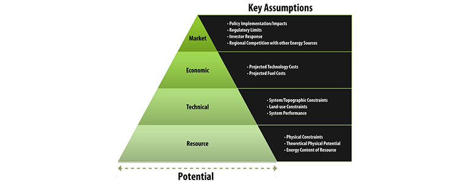

#+title: Energy Resource Analysis

* energy resource anaylsis

** energy technical potential

- the energy technical potential of a technology is its achievable energy generation given system performance, topographic, environmental, and land-use constraints

*assessing technical potential establishees an upper-boundary estimate of development potential*
- there are multiple types of potential
  1. resource
     2. technical
        3. economic
           4. market

              

** NRL's energy technical potential 2012 report

the technical potential of specific renewable electricity generation technologies
- there are specific estimates of energy generation potential
  - based only on...
    - renewable resource availability and quality
    - technical system performance
    - topographic limitations
    - environmental
    - land-use constraints

*** methodology
spatial analysis calculating renewable energy technical potential
- reporting...
  - land area sqkm
  - installed capacity
  - electricity generation
  for...
  - utility-scale photovoltaic
  - solar power
  - offshore/onshore wind power
  - biopower
  - geothermal systems
    each system-specific power density, capacity factor, and land-use constraints
    - were identified using published research, subject matter experts, and analysis

/heavily relying on System Advisor Model (SAM) AND Regional Energy Deployment System (ReEDS)/
*multi-regional, multi-time period, GIS, and linear programming model*

*** utility scale photovoltaic (urban)

$State MWh = State \sum [urban openspace(km^2) \cdot power density (48\frac{MW}{km^2})\cdot state capacity factor (%) \cdot 8760 (hours per year)]$
*** enhance geothermal systems

We derive technical potential estimates for enhanced geothermal systems (EGS) from temperature at depth data obtained from the Southern Methodist University’s (SMU)
Geothermal Laboratory.

- the data ranged from 3k to 10km in depth
  - viable regions temperatures greater than 150 celcius
- we apply known potential energy capacity $MW_e/km^3$
  - to each temperature-depth interval
    - to estimate total potential at each depth interval
      - based on the total volume of each unique temperature-depth interval

- Electric generation potential calculations summarize the technical potential $MW$
  - at all depth intervals
- electric generation potential $GWh$
  - at all depth intervals with a 90% capacity factor
    - and annual electic generation potential $GWh$ only at optimum depth
      - we determine optimum depth by a quantative analysis
        - of levelized cost of electricity (LCOE)

/an optimum depth is found because drilling costs increase with depth while temperature, and therefore power plant efficiency, generally increase with depth so that power plant costs decrease with depth/
- because drilling costs are increasing while power plant costs are decreasing
  - on a per $MW$ basis, at some point there is a minimum

*** natural gas fire generation
- gas delivery and gas fire generation
