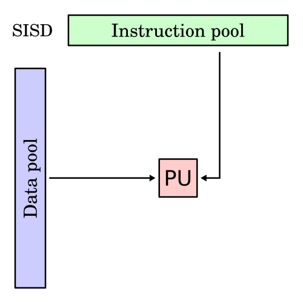
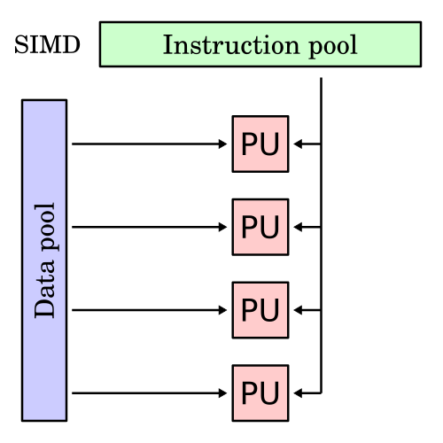
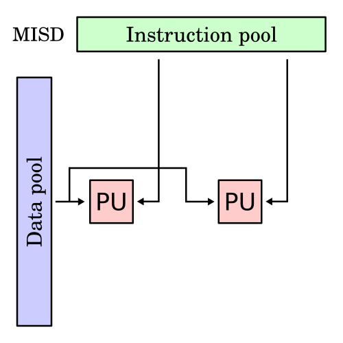
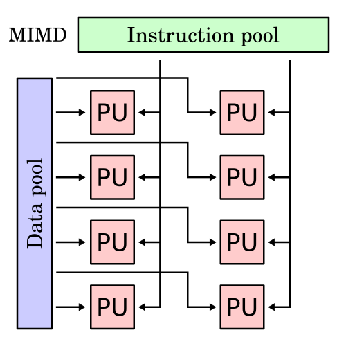

#+title: Duncan And Flynns Taxonomy

* classification of computer architectures

* Flynn's taxonomy

** overview
classification of computer architectures (1966)
- since the rise of CPUs
  - a multiprogramming context evolved as an extension of the system

    *4 initial classifications based upon the number of concurrent instruction streams*
    - and datastreams available in the architecture

*** background

/Bandwidth/ is an expression of time-rate of occurence
- computational or execution bandwidth
  - is the number of instructions processed per second
- storage bandwidth
  - is the retrieval rate of operand and operation memory words (words/second)

/Latency/ or latent period is the total time associated with processing
- of a data unit at a phase in the computing process

  - the ratio of the number of simulataneous instructions being processed
    - to this constrained multiplicity is called the /Confluence/
      - or concurrence of the system

** single instruction stream, single data stream SISD
- sequential computer which exploits no parallelism in either the instruction or datastreams

- single control unit (CU) fetches a single instruction stream (IS) from memory
 - CU generates appropriate control signals to direct a single processing element (PE) to operate on a single data stream (DS)
   /one operation at a time/

   

** single instruction stream, multiple data streams SIMD

- a single instruction is simultaneously applied to different data streams
  - instructions can be executed sequentially (pipelining)
    - or in parallel by multiple functional units

      _SIMD is broken down into 3 categories_

      *array processor* known as *SIMT*
      - recieves same instruction
        - but each parallel processing unit
          - has its own distinct memory and register file
      *pipelined processor*
      - recieves the same instruction
        - but then read data from a central resource
          - each processes fragments of that data
            - then writes back results to same central resource
      *associative processor*
      - recieves the same instruction
        - but in addition a register value
          - from the CU is also broadcast to each PU
            - in each PU an independent decision is made
              - based on data local to the unit
                - comparing against the broadcast value
                - as to whether perform the broadcast instruction, or to skip it

** multiple instruction streams, single data stream

- uncommon architecture
  - generally used for fault tolerance
- heterogeneous system operate on the same data stream
  - and must agree on the result

e.g. Space Shuttle Flight Control Computer

** multiple instruction streams, multiple data streams

- includes multi-core superscalar processors
  - and distributed systems
    - using either one shared memory space or a distributed memory space

* Duncan's taxonomy
